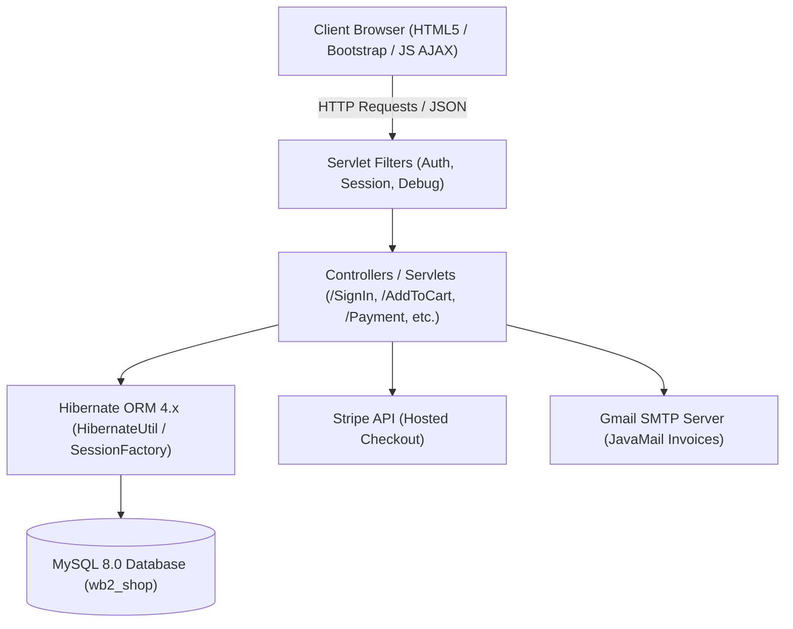
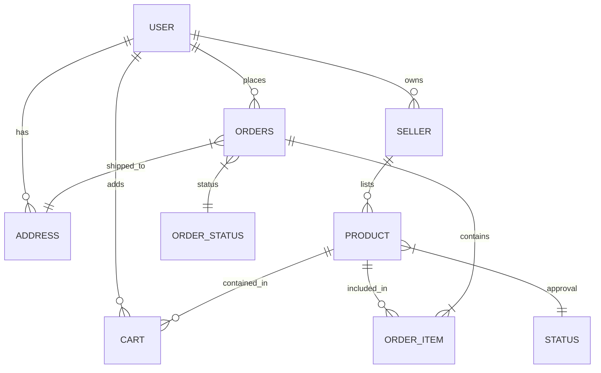
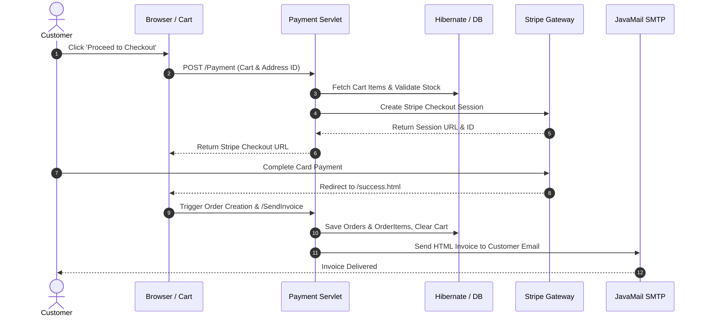

# About E-Store 🛒

**E-Store** is a comprehensive, full-featured multi-vendor e-commerce web platform built with **Java Enterprise Edition (Java EE)**, **Hibernate ORM**, **MySQL**, and **Stripe Checkout API**.

The application provides an end-to-end shopping experience for customers, a dedicated management suite for sellers, and an administrative panel for order and catalog oversight.

---

## 🏗️ System Architecture

The project follows the standard **Model-View-Controller (MVC)** architectural pattern:

### 1. View Layer (Frontend)
- **HTML5 & CSS3**: Modern, responsive layout with mobile and desktop support.
- **JavaScript & AJAX (Fetch/XHR)**: Asynchronous requests for seamless UX without full page reloads.
- **UI Components**: Product carousels (Slick Slider), interactive modals, and responsive data tables.

### 2. Controller Layer (Servlets & Filters)
- **Servlets**: Dedicated HTTP endpoints handling JSON and form requests (`SignIn`, `SignUp`, `AddToCart`, `Payment`, `ProductInsert`, `OrderManagement`, etc.).
- **Filters**:
  - `SessionFilter` & `SignInCheckFilter`: Safeguard protected pages from unauthorized access.
  - `EditProfileFilter`: Validates authentication state before allowing profile adjustments.
  - `SessionDebugFilter`: Logs session lifecycle events during development.

### 3. Model Layer (Data & Business Logic)
- **Hibernate ORM**: Maps Java POJO entities directly to MySQL relational tables.
- **Stripe Service**: Generates payment checkout sessions and handles redirection.
- **Mail Service**: Dispatches HTML verification codes and order invoices via SMTP.

---

## 💾 Database Schema & ER Model

The relational database (`wb2_shop`) stores users, sellers, products, shopping carts, addresses, and order details:

### Database Tables:
- **`user`**: Stores user credentials, contact details, and email verification tokens.
- **`seller`**: Stores merchant details, store name, description, tax ID, and contact email.
- **`product`**: Product catalog items with titles, pricing, inventory quantities, images, and seller references.
- **`cart`**: Persistent cart items linked to registered users.
- **`address`**: User shipping and billing addresses.
- **`orders`**: Placed customer orders with timestamp, total amount, shipping address, and current status.
- **`order_item`**: Line items within an order (product snapshot and quantity).
- **`order_status`**: Lookup table for order progression (*Pending*, *Processing*, *Shipped*, *Delivered*, *Cancelled*).
- **`status`**: Product approval status (*Pending*, *Approved*).

---

## 🚀 Key Modules & Features

### 1. User & Authentication Management
- **Registration**: Client-side and server-side validation with secure password complexity checks.
- **Email Verification**: Sends a 6-digit confirmation code to the user's email upon signup.
- **Session Management**: Session-based login with automatic authentication verification across protected routes.
- **Profile Editing**: Users can update names, contact info, shipping addresses, and change passwords.

### 2. Product Catalog & Storefront
- **Featured & Recent Products**: Dynamic querying based on recency and seller status.
- **Product Details Modal**: Instant modal popups showing multi-angle images, description, pricing, and stock status.
- **Search & Filtering**: Search products by title, category, or keywords using Hibernate Criteria API.

### 3. Seller System
- **Seller Registration**: Existing users can register as verified sellers by providing store details and tax IDs.
- **Product Listing**: Sellers can list products with multiple image uploads, stock counts, and detailed descriptions.

### 4. Cart & Checkout Workflow

### 5. Admin & Order Management Dashboard
- **Order Tracking**: Visual dashboard listing all incoming orders with order IDs, timestamps, customer details, addresses, and line items.
- **Status Updates**: Real-time order state updates (*Pending* ➔ *Processing* ➔ *Shipped* ➔ *Delivered*).
- **Product Catalog Management**: Quick-access form to insert or update product information.

---

## 🔒 Security & Best Practices

1. **Credentials Externalization**:
   - Database credentials, Stripe secret keys, and email credentials use environment variables or centralized configuration files rather than hardcoded production values.
2. **Access Control**:
   - Protected routes use servlet filters (`SignInCheckFilter`) to redirect unauthenticated visitors to login.
3. **Prepared Statements & ORM**:
   - Hibernate parameterized queries prevent SQL injection vulnerabilities.
4. **Input Validation**:
   - Server-side regex validation on emails, passwords, and phone numbers before database commits.
