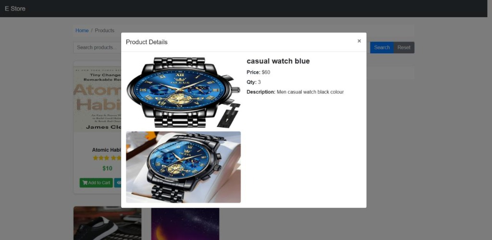
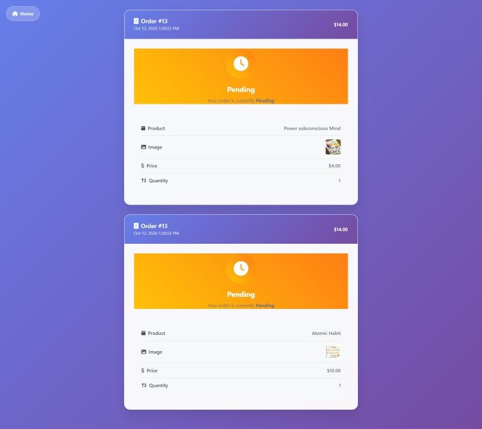
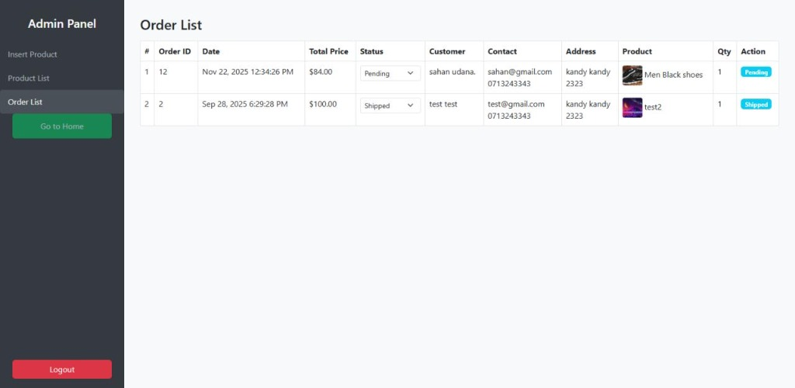
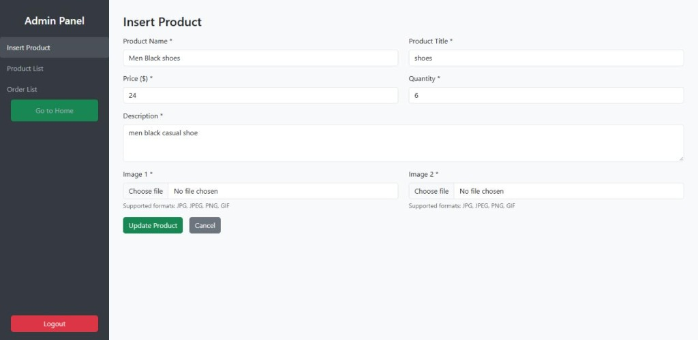

# E-Store 🛍️

[](https://www.oracle.com/java/)
[](https://hibernate.org/)
[](https://www.mysql.com/)
[](https://stripe.com/)
[](https://getbootstrap.com/)

A modern, full-featured multi-vendor E-Commerce web application built using **Java EE (Servlets & Filters)**, **Hibernate ORM**, **MySQL**, and **Stripe Payment Gateway**.

---

## 📸 Screenshots

### 1. Storefront & Home Page


### 2. Interactive Product Details


### 3. Customer Order Tracking & Status


### 4. Admin Panel - Order Management


### 5. Admin Panel - Product Insertion & Inventory Management


---

## ✨ Features

- **Customer Experience:**
  - Responsive catalog with featured and recent products.
  - Interactive product detail modal with multi-image previews.
  - Real-time product search and category filtering.
  - Persistent shopping cart per user session.
  - Multi-address checkout flow.
  - Live order tracking (*Pending*, *Processing*, *Shipped*, *Delivered*).

- **Multi-Vendor & Seller System:**
  - Dedicated seller registration with store details & tax ID verification.
  - Seller portal to upload products with multiple images, pricing, and quantities.

- **Admin Operations:**
  - Order management dashboard to track customer purchases and change fulfillment status.
  - Product catalog management and updates.

- **Payment & Communications:**
  - Integrated **Stripe Checkout** for card payments.
  - Automated transactional emails with **JavaMail** (signup verification code & HTML invoices).

For an in-depth architectural breakdown and database design, check out [ABOUT.md](ABOUT.md).

---

## 🛠️ Tech Stack

- **Backend:** Java EE (Servlets, HTTP Session, Filters), JavaMail API
- **ORM:** Hibernate 4.x
- **Database:** MySQL 8.0
- **Frontend:** HTML5, CSS3, JavaScript (AJAX / Fetch API), Bootstrap, Slick Slider
- **Payment Processing:** Stripe Java SDK & Stripe.js
- **Server:** GlassFish / Apache Tomcat
- **Build Tool:** Apache Ant (NetBeans project structure)

---

## 🚀 Getting Started

### Prerequisites

- **JDK 8 or higher**
- **Apache NetBeans IDE** (or Eclipse / IntelliJ IDEA with Java EE support)
- **GlassFish Server 4.x / 5.x** (or compatible Servlet container like Tomcat)
- **MySQL Server 8.0+**
- **Stripe Account** (for test API keys)

---

### Installation & Setup

#### 1. Clone the repository
```bash
git clone https://github.com/Thilankalhara/E-Store.git
cd E-Store
```

#### 2. Import Database
1. Open MySQL Workbench, HeidiSQL, or MySQL CLI.
2. Run the SQL script located at [`E-store.sql`](E-store.sql) to set up the database and default tables:
   ```sql
   mysql -u root -p < E-store.sql
   ```
   *(This creates the `wb2_shop` database with pre-configured schemas and sample data).*

#### 3. Configure Database Connection
Edit [`src/java/hibernate.cfg.xml`](src/java/hibernate.cfg.xml) to match your local MySQL credentials:
```xml
<property name="hibernate.connection.url">
    jdbc:mysql://localhost:3306/wb2_shop?useSSL=false&amp;allowPublicKeyRetrieval=true&amp;serverTimezone=UTC
</property>
<property name="hibernate.connection.username">YOUR_DB_USERNAME</property>
<property name="hibernate.connection.password">YOUR_DB_PASSWORD</property>
```

#### 4. Configure Stripe Keys
- **Backend**: Set the environment variable `STRIPE_SECRET_KEY` or edit [`src/java/controller/Payment.java`](src/java/controller/Payment.java):
  ```java
  private static final String STRIPE_SECRET_KEY = System.getenv("STRIPE_SECRET_KEY") != null 
          ? System.getenv("STRIPE_SECRET_KEY") 
          : "YOUR_STRIPE_SECRET_KEY";
  ```
- **Frontend**: Insert your Stripe Publishable Key in [`web/checkout.html`](web/checkout.html):
  ```javascript
  const stripe = Stripe('YOUR_STRIPE_PUBLISHABLE_KEY');
  ```

#### 5. Configure Email Service (Optional for Invoices & Verification)
Configure environment variables `APP_EMAIL` and `APP_PASSWORD` or edit [`src/java/model/Mail.java`](src/java/model/Mail.java) with your Gmail SMTP credentials.

#### 6. Run the Application
1. Open the project in **NetBeans IDE**.
2. Resolve any missing server targets by selecting your **GlassFish** or **Tomcat** instance.
3. Clean and Build the project.
4. Click **Run** or deploy the generated `.war` onto your application server.
5. Visit `http://localhost:8080/E-Store/` (or your configured context root).

---

## 📄 License & Credits

Developed by **[Thilan Kalhara](https://github.com/Thilankalhara)**.
Released under the [MIT License](LICENSE).
